<div align="center">

# Choose your Krishna

**A portfolio built like a game's character-select screen.**
One person, two playable classes — **the Editor** and **the Engineer**.

[**Live site → krishnasharma.online**](https://www.krishnasharma.online)


<br/>

<a href="https://www.krishnasharma.online">
  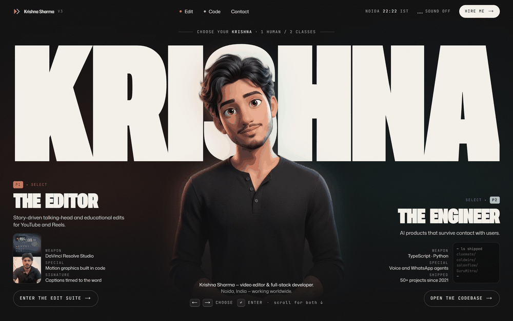
</a>

<sub>Press ← / → on the hero and the whole page re-grades: <b>tungsten orange</b> for the editor, <b>teal</b> for the engineer.</sub>

</div>

---

## Table of contents

- [Screenshots](#screenshots)
- [About](#about)
- [Features](#features)
- [Tech stack](#tech-stack)
- [Getting started](#getting-started)
- [Scripts](#scripts)
- [Project structure](#project-structure)
- [Make it your own](#make-it-your-own)
- [Media pipeline](#media-pipeline)
- [Deploying](#deploying)
- [SEO](#seo)
- [Implementation notes](#implementation-notes)
- [License](#license)

## Screenshots

### Choose your class

<table>
  <tr>
    <td width="33%">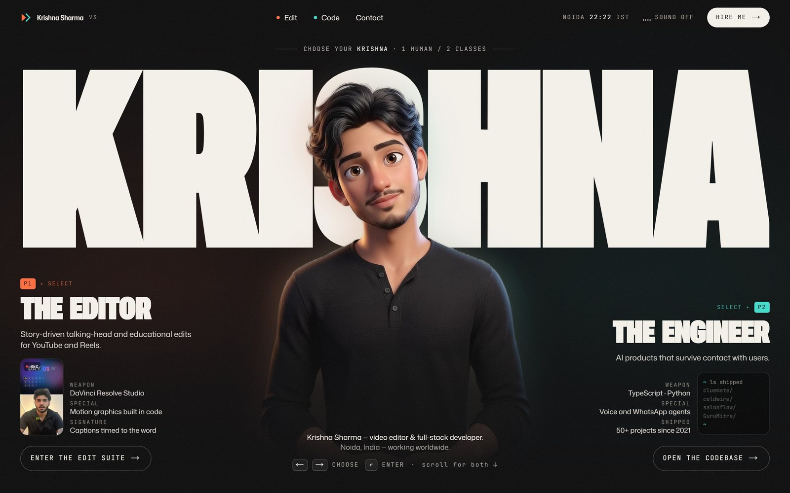</td>
    <td width="33%">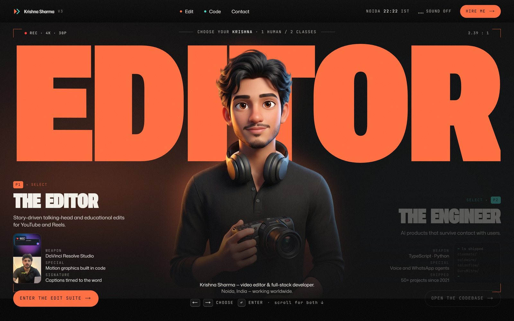</td>
    <td width="33%">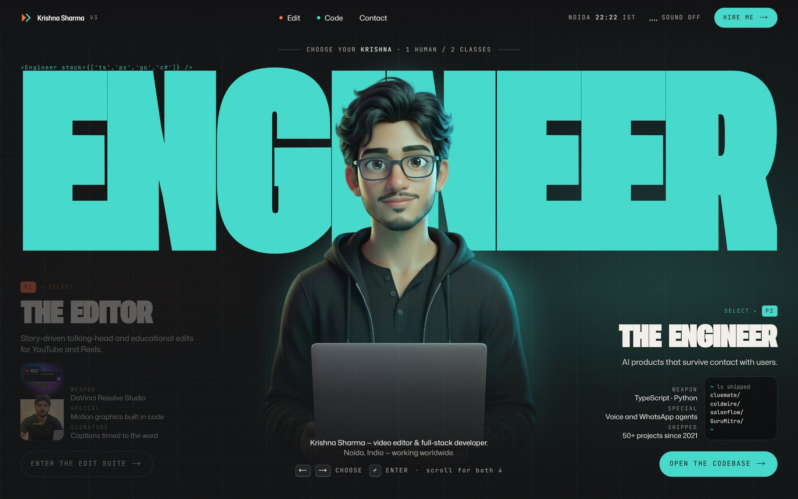</td>
  </tr>
  <tr>
    <td align="center"><b>Neutral</b> — ungraded black &amp; white</td>
    <td align="center"><b>P1 · The Editor</b> — tungsten orange</td>
    <td align="center"><b>P2 · The Engineer</b> — teal</td>
  </tr>
</table>

### Home

<table>
  <tr>
    <td width="50%">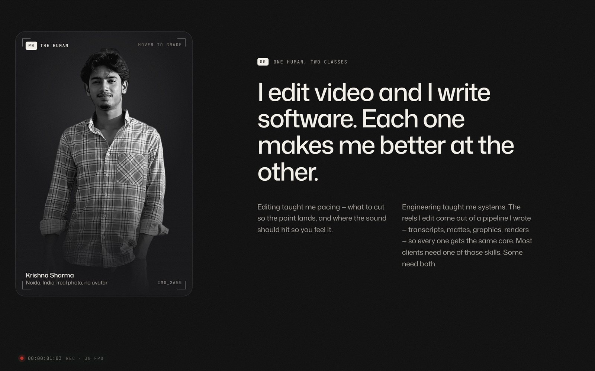</td>
    <td width="50%">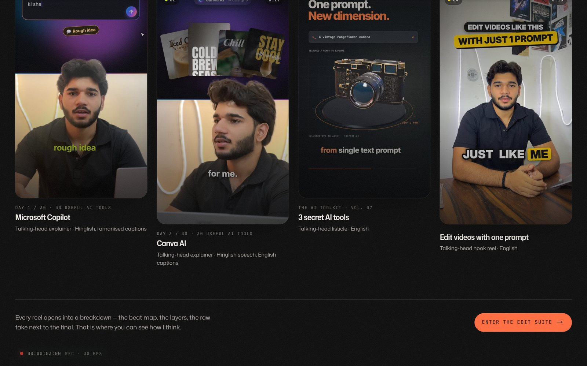</td>
  </tr>
  <tr>
    <td align="center"><b>P0 — the human</b>: real photo, graded on hover</td>
    <td align="center"><b>Edits that hold attention</b>: delivered reels</td>
  </tr>
</table>

<p align="center">
  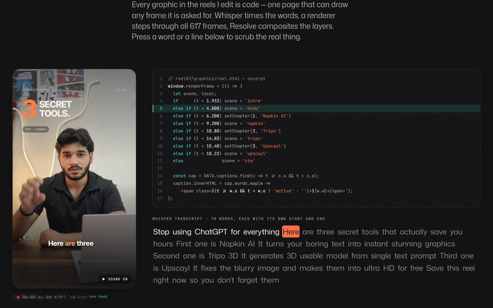
  <br/><sub><b>Co-op mode — an edit is a function of <i>t</i>.</b> The reel's real renderer code and word-level transcript, synced to the playing video.</sub>
</p>

### `/edit` — the edit suite

<p align="center">
  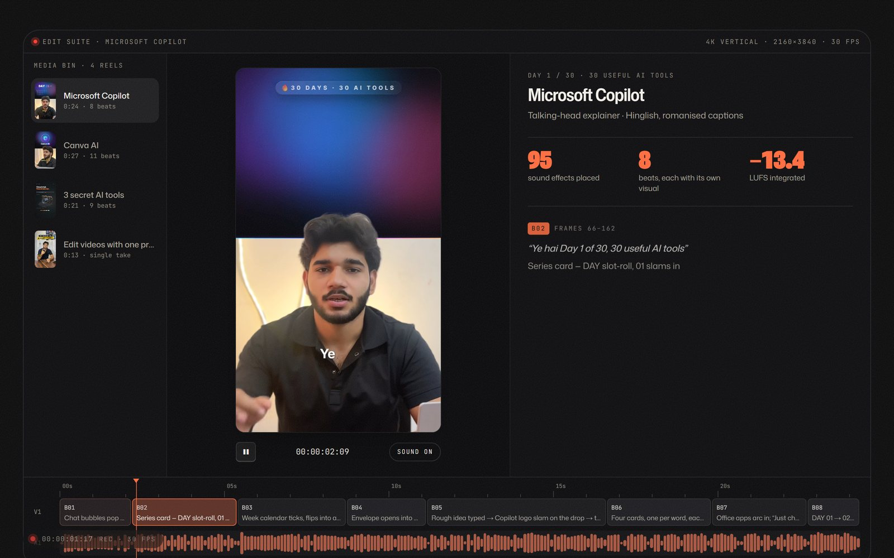
  <br/><sub><b>Every beat has a job.</b> A mini NLE with each reel's real beat map and measured waveform.</sub>
</p>

<table>
  <tr>
    <td width="50%">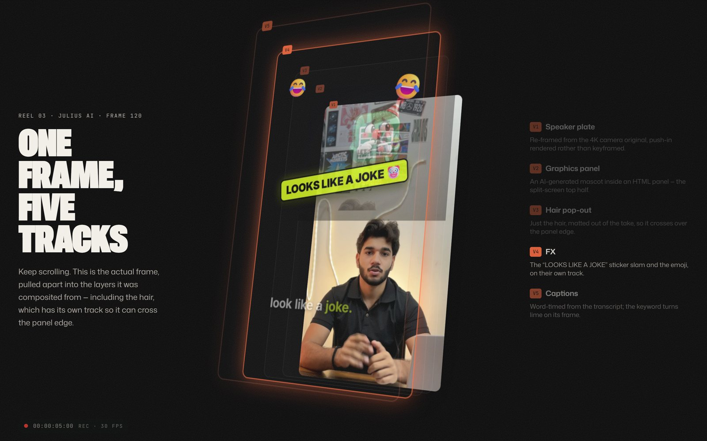</td>
    <td width="50%">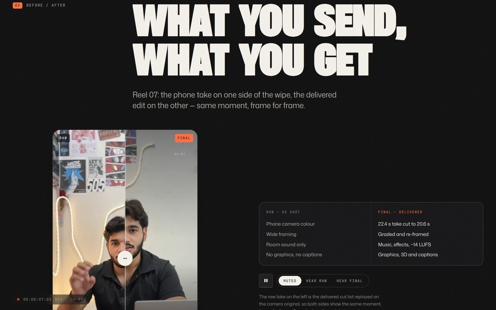</td>
  </tr>
  <tr>
    <td align="center"><b>One frame, five tracks</b>: the exploded edit in 3D</td>
    <td align="center"><b>Raw ⟷ final</b>: frame-aligned before/after wipe</td>
  </tr>
</table>

### `/code` — the codebase

<table>
  <tr>
    <td width="50%">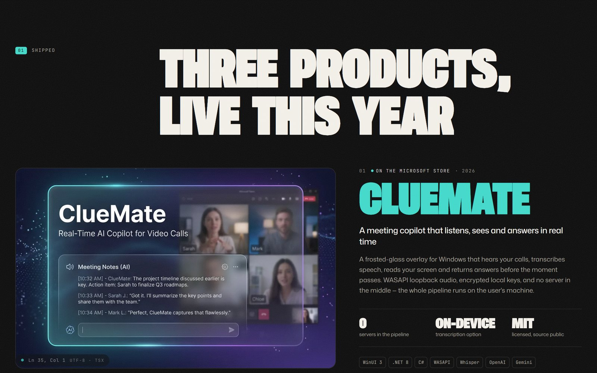</td>
    <td width="50%">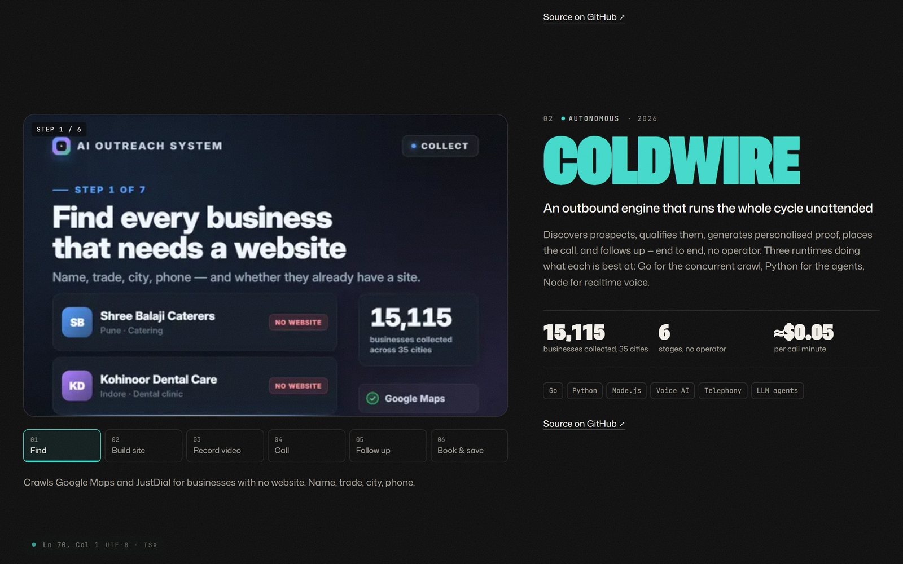</td>
  </tr>
  <tr>
    <td align="center"><b>ClueMate</b>: real-time AI copilot for video calls</td>
    <td align="center"><b>Coldwire</b>: autonomous outbound engine</td>
  </tr>
</table>

### Mobile

<p align="center">
  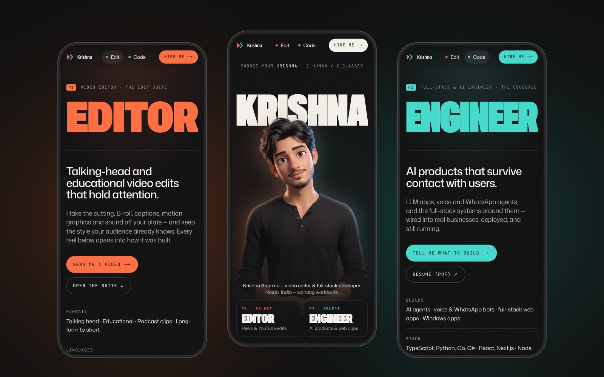
</p>

## About

The site opens on a character-select screen: the same person can be played as
**the Editor** or **the Engineer**. Hover a side — or press <kbd>←</kbd>
<kbd>→</kbd> and <kbd>Enter</kbd> — and the whole page re-grades. Scroll instead
and you get both.

The palette is the most famous colour grade in film, **teal and orange**:
tungsten orange belongs to the editor, teal to the engineer, and black-and-white
is the ungraded "neutral" state.

Nothing on the site is a mock-up:

- **Reels** are the delivered finals, re-encoded for the web.
- **Beat maps** come from each reel's edit plan; **waveforms** are measured from
  each reel's final mix.
- **Exploded edit** shows one reel's actual track layers at a single frame.
- **Raw ⟷ final** replays a camera original on the delivered cut list, so both
  sides are frame-aligned.
- **`renderFrame(t)`** shows a reel's real renderer logic and word timings,
  synced to the playing video.

### Pages

| Route | What it is |
| --- | --- |
| `/` | Character select → "one human, two classes" → the editor's chapter (reels) → the engineer's chapter (shipped products) → co-op → contact → end credits |
| `/edit` | The edit suite: a mini NLE with each reel's beat map and waveform, the exploded-layers breakdown, raw ⟷ final wipe, services, process, toolkit |
| `/edit/[slug]` | One page per reel, so each sample is linkable |
| `/code` | Case studies, project index, `git log --career`, and the stack with receipts |

## Features

- 🎮 **Character-select hero** — keyboard and pointer driven, with a 3D avatar
  per class and a seamless idle loop.
- 🎞️ **Alpha video in every browser** — a "stacked alpha" MP4 recombined by a
  two-line WebGL shader (works in Safari too).
- ⚡ **AV1 first, H.264 fallback** — exact codec strings let each browser pick
  before downloading a byte; broken AV1 decoders are detected and switched.
- 💤 **Lazy everything** — no video downloads on page load; each one warms up as
  it nears the viewport and pauses when it leaves. Respects Save-Data and slow
  connections.
- 🔤 **42 KB display font** — Roboto Flex instanced and subset; giant headlines
  solve their own `font-stretch` to span the screen edge to edge.
- ♿ **Reduced-motion aware** — no entrance, no pinned 3D, no smooth scroll.
- 🔊 **Synthesised UI sound** with Web Audio — no audio files, off by default.
- 🔎 **SEO done properly** — one schema.org graph, video sitemap, `llms.txt`,
  IndexNow pings after deploy.
- 🌍 **Static export on the edge** — HTML/JS/images are static assets; a tiny
  Worker serves video from R2 with byte ranges.

## Tech stack

| Area | Tools |
| --- | --- |
| Framework | [Next.js 16](https://nextjs.org) (static export), React 19, TypeScript |
| Styling | Tailwind CSS 4 |
| Motion | Web Animations API, [GSAP](https://gsap.com) + ScrollTrigger (`/edit` only), [Lenis](https://lenis.darkroom.engineering) |
| Hosting | Cloudflare Workers (static assets) + R2 (video) via [Wrangler](https://developers.cloudflare.com/workers/wrangler/) |
| Media tooling | Python, FFmpeg, Pillow, OpenCV, rembg (BiRefNet), pymatting, ONNX Runtime |

## Getting started

### Prerequisites

- **Node.js 20+** and npm
- *(optional)* a Cloudflare account, only if you want to deploy
- *(optional)* Python 3.10+ and FFmpeg, only if you want to regenerate media

### Run locally

```bash
git clone https://github.com/krishnasharma2212/PortfolioWebsite.git
cd PortfolioWebsite
npm install
npm run dev
```

Open <http://localhost:3000>. All media is already in `public/`, so the site
runs fully without any extra setup.

### Environment variables (all optional)

Create a `.env.local` if you need any of these:

| Variable | Purpose | Default |
| --- | --- | --- |
| `NEXT_PUBLIC_SITE_URL` | Production URL used for canonical links, sitemap and Open Graph | `https://www.krishnasharma.online` |
| `NEXT_PUBLIC_GOOGLE_SITE_VERIFICATION` | Google Search Console meta-tag verification | — |
| `NEXT_PUBLIC_BING_SITE_VERIFICATION` | Bing Webmaster Tools meta-tag verification | — |

## Scripts

| Command | What it does |
| --- | --- |
| `npm run dev` | Dev server at `http://localhost:3000` |
| `npm run build` | Static export into `out/` (plus media manifest and post-build fixes) |
| `npm start` | Serve the built `out/` folder |
| `npm run lint` | ESLint |
| `npm run preview` | Build, then run the real Worker locally with `wrangler dev` and a local R2 |
| `npm run media:upload` | Upload changed videos to R2 |
| `npm run deploy` | Build → upload changed videos → deploy both Workers → ping IndexNow |

## Project structure

```
.
├── src/
│   ├── app/                 # Routes: /, /edit, /edit/[slug], /code, sitemap, robots, manifest, llms.txt
│   ├── components/
│   │   ├── hero/            # Character select, alpha video, giant word
│   │   ├── edit/            # Edit suite, exploded edit, raw ⟷ final, reel cards
│   │   └── code/            # Project rows, build stages
│   └── lib/
│       ├── content.ts       # ← every fact and line of copy on the site
│       ├── seo.ts           # Titles, descriptions, Open Graph, schema.org graph
│       ├── media.ts         # Hashed media URLs from the manifest
│       ├── waves.ts         # Measured waveforms
│       └── reel07.ts        # Renderer logic + word timings for renderFrame(t)
├── public/
│   ├── media/               # Encoded reels, hero loop, posters (generated)
│   ├── og/                  # Share cards (generated)
│   ├── work/                # Project screenshots
│   └── _headers             # Cache headers for Cloudflare static assets
├── worker/
│   ├── index.ts             # Serves /media/*.mp4 from R2 with Range/ETag support
│   └── apex.ts              # 301s apex + plain-http to https://www
├── scripts/                 # Media manifest, post-build fixes, R2 upload, IndexNow
├── _source/                 # Python media pipeline (avatar cut-outs, encodes, OG cards)
├── docs/                    # SEO playbook, notes and README screenshots
├── ASSETS.md                # Prompts used to generate the 3D avatar
├── wrangler.jsonc           # Main Worker config
└── wrangler.apex.jsonc      # Redirect Worker config
```

## Make it your own

The code is designed so that **one file holds all the content**:
[`src/lib/content.ts`](src/lib/content.ts). Profile, links, reels, projects,
services, toolkit, education and FAQ all live there.

1. **Content** — edit `src/lib/content.ts`. Empty fields are hidden (e.g. fill in
   `profile.links.instagram` / `youtube` and they appear in the contact block and
   structured data).
2. **Domain** — set `NEXT_PUBLIC_SITE_URL`, and update `routes` in
   `wrangler.jsonc` / `wrangler.apex.jsonc` with your own zone.
3. **Cloudflare** — replace `account_id` in both Wrangler configs and the R2
   bucket name (`wrangler.jsonc` and `scripts/upload-media.mjs`).
4. **Media** — replace the files in `public/` with your own (see below), then
   run `npm run build` so the media manifest picks up the new hashes, sizes and
   codec strings.
5. **IndexNow** — generate your own key and replace
   `public/<32-hex-key>.txt` (the file name and its content are the key).
6. **Freshness** — bump `site.updated` in `content.ts` whenever copy changes; it
   is the sitemap's `lastmod` and the pages' `dateModified`.

> **Please don't reuse the personal content.** The reels, photos, avatar,
> résumé and written copy belong to Krishna Sharma — swap them for your own.
> See [License](#license).

### Adding a reel

1. Add the final export to `REELS` in `_source/build_media.py` (poster time,
   preview start) and run `python _source/build_media.py`.
2. Add its entry to `reels` in `content.ts`: facts, beats, what you did.
3. Re-run `python _source/build_og.py` to regenerate the share cards.

## Media pipeline

`_source/build_media.py` regenerates everything in `public/media` from the
original exports. Colour stays BT.709 in and out, matching the reels.

> The scripts point at source folders on the author's machine (e.g. the
> `DV` path at the top of `build_media.py`). Change them to your own paths
> before running.

| Output | Size |
| --- | --- |
| Reel `full.av1.mp4` — 720×1280 AV1 + Opus | 1.5–2.4 MB each (what most browsers play) |
| Reel `full.mp4` — 720×1280 H.264 + AAC | 2.5–4.8 MB each (fallback, and what crawlers index) |
| Reel `preview(.av1).mp4` — 6 s, 480p, muted | 0.2–0.5 MB each (card autoplay) |
| Hero looks + portrait — AVIF (WebP fallback) | 46–198 KB |
| Posters — WebP | 11–70 KB |
| Breakdown layers — WebP with alpha | ~180 KB total |

AV1 CRFs were chosen by VMAF against the 4K masters: the full reels score ~96
against H.264's 95.7 at about half the bytes.

### The avatar

The hero character was generated with Gemini (Nano Banana Pro for the three
looks, Veo for the idle loop — prompts in [ASSETS.md](ASSETS.md)). All looks are
cropped to the same 1532 × 2300 frame so the head never moves when the class
changes.

- `avatar_cutouts.py` — BiRefNet in two passes (head, then figure) plus a
  pymatting foreground estimate.
- `avatar_idle.py` — aligns the Veo loop to the stills (SIFT + RANSAC), mattes
  each frame with RobustVideoMatting, and eases the last frames into frame 0 so
  the loop has no seam.
- `avatar_prep.py` — premultiplied resizing and colour padding under transparent
  pixels, so 4:2:0 encoders never smear a dark outline onto the edge.

The loop is **stacked alpha**: colour in the top half, matte in the bottom half,
one ordinary video file that
[`AlphaVideo.tsx`](src/components/hero/AlphaVideo.tsx) recombines in WebGL. It
loads on idle after the entrance, is skipped for reduced motion / Save-Data /
slow connections, and pauses when off screen.

## Deploying

The site is a static export (`output: "export"`) served from Cloudflare's edge.
Only two kinds of request run code ([`worker/index.ts`](worker/index.ts)):

- **`/media/**/*.mp4`** — videos live in R2, because static assets don't answer
  Range requests and Safari won't play video without them. The Worker serves
  byte ranges, ETag/304 and 416, and caches each file at the edge.
- **Paths containing `$`** — the router's segment prefetches, fetched directly in
  their `%24` form instead of costing a redirect.

Everything else is a static asset. Cache headers live in
[`public/_headers`](public/_headers) (hashed files: one year, immutable; HTML:
revalidate). [`worker/apex.ts`](worker/apex.ts) redirects the bare domain and
plain-http `www` to `https://www`, keeping path and query.

```bash
npx wrangler login
npx wrangler r2 bucket create <your-bucket>
npm run deploy
```

## SEO

- [`src/lib/seo.ts`](src/lib/seo.ts) builds titles, descriptions, Open Graph and
  one schema.org graph: a `Person` referenced by `@id` from every page, a
  `ProfilePage` for home, `Service` + `FAQPage` for `/edit`, and a `VideoObject`
  (with transcript) per reel.
- `sitemap.xml` carries a video entry per reel; `robots.txt`, `llms.txt` and the
  web manifest are generated at build.
- [`scripts/indexnow.mjs`](scripts/indexnow.mjs) pings IndexNow (Bing, Yandex
  and others) with every URL after a deploy.
- Off-site to-dos are in [docs/SEO-PLAYBOOK.md](docs/SEO-PLAYBOOK.md).

## Implementation notes

- **Next.js 16.4, static export.** Cache Components is off: the export needs
  `dynamic = "force-static"` on robots/sitemap/manifest/llms.txt, which Cache
  Components rejects. `/edit/[slug]` sets `dynamicParams = false`.
- **`scripts/postbuild.mjs`** flattens the router's prefetch files: on Windows,
  Next 16.4 writes `__next.code/__PAGE__.txt` where the client asks for
  `__next.code.__PAGE__.txt`.
- **`experimental.inlineCss` stays off** — in 16.4 it also copies the stylesheet
  into the RSC payload (index.html went from 26 to 65 KB gzipped).
- **GSAP loads only on `/edit`.** The hero entrance uses Web Animations; Lenis
  runs its own frame loop.
- **No flash before hydration.** The entrance is held by `html.intro`, set by an
  inline script before first paint; a CSS fallback reveals everything after
  3.2 s if the script never runs.
- **CSS layers matter.** Global styles live in `@layer base` /
  `@layer components` — unlayered CSS beats every Tailwind utility.

## License

- **Code** (everything under `src/`, `worker/`, `scripts/`, `_source/` and the
  config files) is released under the [MIT License](LICENSE) — use it, fork it,
  learn from it.
- **Personal content is not covered**: the photos, avatar images and video, the
  reels, the résumé, the share cards and the written copy in
  `src/lib/content.ts` are © Krishna Sharma, all rights reserved.
- The Roboto Flex font is under the
  [SIL Open Font License](src/app/fonts/RobotoFlex-OFL.txt).

---

<div align="center">

Made by **Krishna Sharma** ·
[krishnasharma.online](https://www.krishnasharma.online)

</div>
